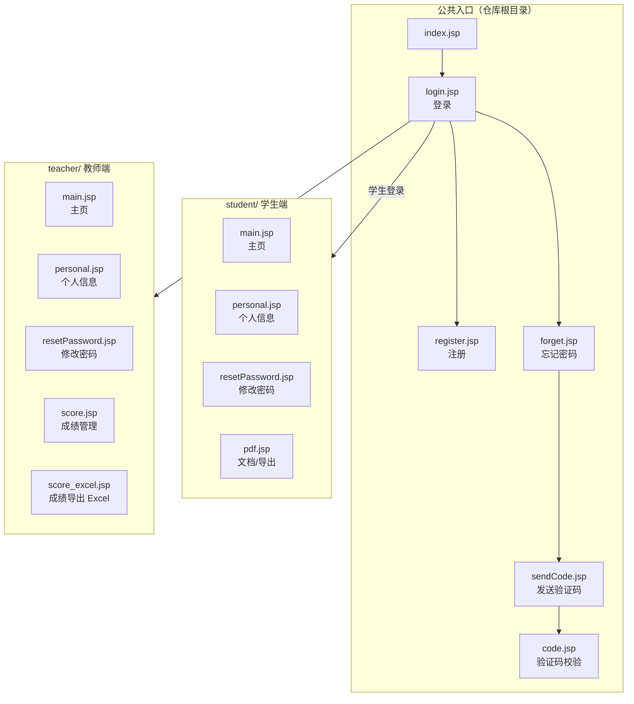

# Student-Information-Management

大二下学期 **JavaWeb 课程设计**练手项目 —— 经典的学生信息管理系统。
作者备注：*「自己本身不是很喜欢，所以最后换了一个项目」*，故本项目停留在课程设计阶段。

> ⚠️ **重要说明：本仓库只包含 JSP 页面，没有 Java 后端源码。**
> 仓库中不存在任何 `.java` 文件，也没有 `web.xml` / `pom.xml` / `build.gradle` 等工程描述文件。
> 因此**本仓库无法独立运行** —— 页面里的表单提交、登录校验、数据存取所依赖的后端（Servlet / DAO / 数据库）
> 均未包含在内。详见 [现状与限制](#现状与限制)。

---

## 页面结构



---

## 页面清单

| 路径 | 说明 |
|---|---|
| `index.jsp` | 入口页 |
| `login.jsp` | 登录页（含前端非空校验 `check(form)`） |
| `register.jsp` | 注册页 |
| `forget.jsp` | 忘记密码 |
| `sendCode.jsp` | 发送验证码 |
| `code.jsp` | 验证码校验 |
| `student/main.jsp` | 学生端主页 |
| `student/personal.jsp` | 学生个人信息 |
| `student/resetPassword.jsp` | 学生修改密码 |
| `student/pdf.jsp` | 学生端文档 / 导出页 |
| `teacher/main.jsp` | 教师端主页 |
| `teacher/personal.jsp` | 教师个人信息 |
| `teacher/resetPassword.jsp` | 教师修改密码 |
| `teacher/score.jsp` | 成绩管理 |
| `teacher/score_excel.jsp` | 成绩导出 Excel |

---

## 前端技术栈

| 项 | 说明 |
|---|---|
| 页面技术 | **JSP**（`<%@ page contentType="text/html;charset=UTF-8" language="java" %>`） |
| 样式框架 | Bootstrap（`resources/css/bootstrap.min.css`） |
| JS 库 | jQuery 1.10.2、jQuery 3.2.1、jQuery UI 1.10.4、Popper |
| 字体 | 微软雅黑（`resources/font/msyh.ttf`） |
| 图标 | `resources/img/` 下的 `user.png`、`password.png`、`email.png` |
| 开发工具 | IntelliJ IDEA（文件头注释：`User: 007`，`Date: 2018/11/1`） |

> 注意：仓库同时引入了 **jQuery 1.10.2 与 3.2.1 两个大版本**，属于冗余依赖。

---

## 目录结构

```
Student-Information-Management/
├── index.jsp  login.jsp  register.jsp
├── forget.jsp  sendCode.jsp  code.jsp
├── student/
│   ├── main.jsp  personal.jsp  resetPassword.jsp  pdf.jsp
├── teacher/
│   ├── main.jsp  personal.jsp  resetPassword.jsp
│   └── score.jsp  score_excel.jsp
└── resources/
    ├── css/     bootstrap.min.css, login.css, register.css, forget.css, default.css, jquery-ui…
    ├── js/      jquery-1.10.2.js, jquery-3.2.1.min.js, jquery-ui…, bootstrap.min.js, popper.min.js
    ├── img/     user.png, password.png, email.png
    └── font/    msyh.ttf
```

---

## 现状与限制

| 项 | 状态 |
|---|---|
| JSP 页面 | ✅ 有（15 个） |
| Java 后端源码 | ❌ **无**（仓库内 0 个 `.java` 文件） |
| 工程描述文件 | ❌ 无 `web.xml` / `pom.xml` / `build.gradle` |
| 数据库脚本 | ❌ 无 |
| 能否直接运行 | ❌ **不能**。缺少后端与数据库，表单提交无处响应 |

**如需运行**，需自行补齐：

1. 一个 Servlet 容器（Tomcat 8/9）
2. 后端 Servlet / DAO 层，实现登录、注册、验证码、成绩查询与导出等逻辑
3. 数据库（学生、教师、成绩、账号等表）与 JDBC 连接配置
4. `web.xml` 或注解形式的 Servlet 映射

页面中引用的 `resources/` 为相对路径，放到 Web 应用的根目录下即可正常加载静态资源。

---

## 归属与许可证

- 本仓库**未附带 LICENSE 文件**。
- 第三方前端库归属：
  - **Bootstrap** —— MIT 许可
  - **jQuery / jQuery UI** —— jQuery Foundation，MIT 许可
  - **Popper** —— MIT 许可
  - **微软雅黑（`msyh.ttf`）** —— 版权归 Microsoft / 方正所有，**不可随意再分发**；
    若公开分发本仓库，建议移除该字体文件并改用系统字体或开源字体。
- 页面结构与样式为课程设计原创部分。
