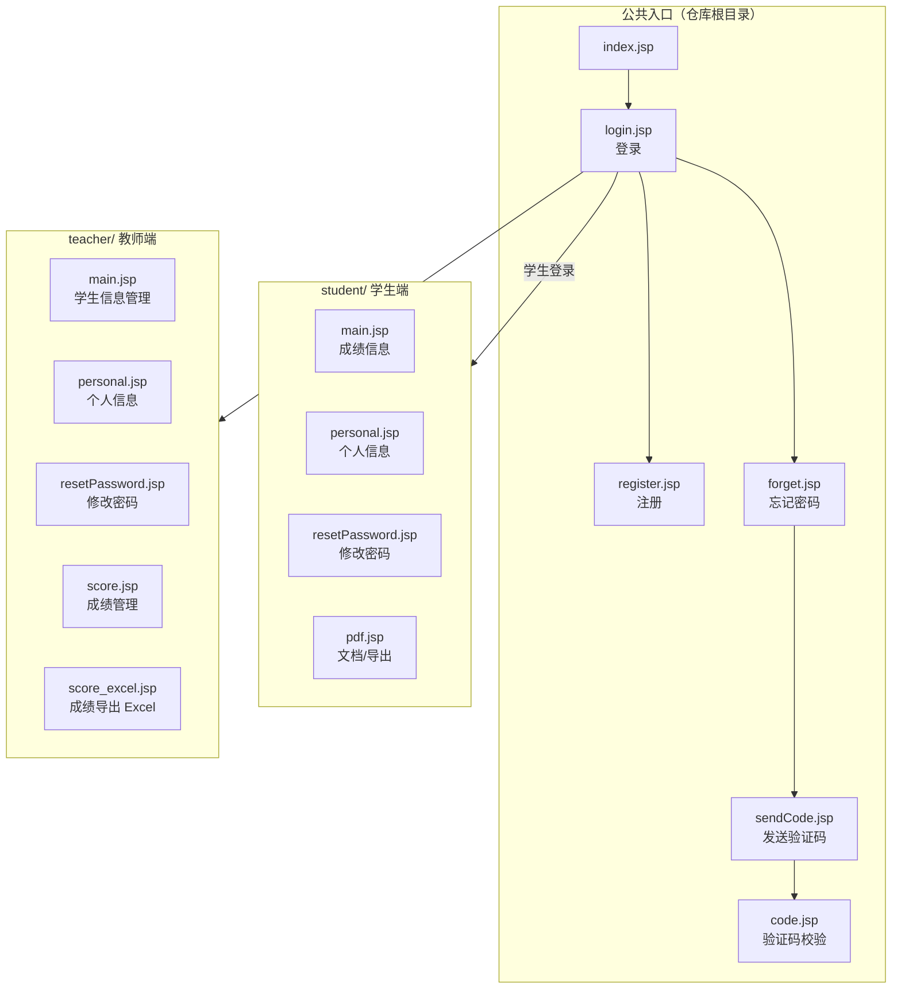

# Student-Information-Management · JavaWeb 课程设计（仅存 JSP 页面）

大二下学期 **JavaWeb 课程设计**练手项目 —— 经典的学生信息管理系统，包含学生端 / 教师端 JSP 页面与前端静态资源。GitHub 描述原文：*「大2下学期javaweb的课程设计，练手项目，因为功能单一传统，自己本身不是很喜欢，所以最后换了一个项目」*。**项目已停留在课程设计阶段，是弃置的练手作业，不是可交付系统。**

> ⚠️ **最重要的一条：本仓库只包含 JSP 页面，没有 Java 后端源码。** 仓库中 0 个 `.java` 文件，也没有 `web.xml` / `pom.xml` / `build.gradle` 等工程描述文件，因此**本仓库无法独立运行** —— 页面里的表单提交、登录校验、数据存取所依赖的后端（Servlet / DAO / 数据库）均未包含在内。详见 [现状与限制](#现状与限制)。

> 🔴 **含上游第三方组件，非全部原创**：`resources/` 下随仓库附有 Bootstrap、jQuery 1.10.2 / 3.2.1、jQuery UI 1.10.4、Popper 等压缩后的第三方前端库副本，权利归各自原作者所有；`dao.*` / `vo.*` 等后端类的来源与权利状态未知。本仓库只有页面结构与样式属于课程设计原创部分，详见 [归属与许可证](#归属与许可证)。

**它在体系里的位置**：独立的课程设计作业仓库，与作者其他机器人 / Web 项目无代码关联。仓库地址 [Student-Information-Management](https://github.com/DLDLDL13579/Student-Information-Management)。

---

## 现状 / 状态表

| 项 | 值 |
|---|---|
| 仓库 | `DLDLDL13579/Student-Information-Management` |
| 可见性 / 默认分支 | 公开 / `main` |
| 主语言 | Java（实际只有 `.jsp`，无 `.java`） |
| 仓库体积 | 9872 KB |
| star / fork | 0 / 0 |
| 创建 / 最后 push | 2024-09-13 / 2026-09-17 |
| GitHub 描述 | 见开头引用，明确写明「最后换了一个项目」 |
| 根目录 LICENSE | **无 LICENSE 文件** |
| 文件数（元数据） | 31 个：`resources`:15、根文件:7、`teacher`:5、`student`:4 |
| 文件树清单条目 | 27 条（差 4 条，见 [已知问题](#已知问题) #2） |
| JSP 页面 | **15 个**（根 6 + `student/` 4 + `teacher/` 5） |
| 已完成 | 15 个 JSP 页面、Bootstrap / jQuery 等静态资源 |
| 未完成 | Java 后端（Servlet / DAO / VO）、数据库与 SQL 脚本、工程描述文件、构建与部署配置、测试 |
| 能否直接运行 | ❌ **不能**，缺少后端与数据库，表单提交无处响应 |
| 定位 | 课程设计练手项目，作者已改用别的题目，**不应写成已验证交付的系统** |

---

## 页面结构



> 该图沿用现有 README 的页面流转示意。**注意**：仓库内没有后端代码，图中「学生登录 / 教师登录」的跳转目标并无对应 Servlet 实现；`student/main.jsp` 的真实标题是「成绩信息」，`teacher/main.jsp` 的真实标题是「学生信息管理」，均按源码原文标注，而非泛称「主页」。

---

## 页面清单（15 个，逐个数过）

| # | 路径 | 说明 |
|---|---|---|
| 1 | `index.jsp` | 入口页 |
| 2 | `login.jsp` | 登录页（现有 README 记载含前端非空校验 `check(form)`） |
| 3 | `register.jsp` | 注册页 |
| 4 | `forget.jsp` | 忘记密码 |
| 5 | `sendCode.jsp` | 发送验证码 |
| 6 | `code.jsp` | 验证码校验 |
| 7 | `student/main.jsp` | 学生端成绩信息页（源码标题「成绩信息」） |
| 8 | `student/personal.jsp` | 学生个人信息 |
| 9 | `student/resetPassword.jsp` | 学生修改密码 |
| 10 | `student/pdf.jsp` | 学生端文档 / 导出页 |
| 11 | `teacher/main.jsp` | 教师端学生信息管理页（源码标题「学生信息管理」） |
| 12 | `teacher/personal.jsp` | 教师个人信息 |
| 13 | `teacher/resetPassword.jsp` | 教师修改密码 |
| 14 | `teacher/score.jsp` | 成绩管理 |
| 15 | `teacher/score_excel.jsp` | 成绩导出 Excel |

---

## 前端技术栈

| 项 | 说明 | 依据 |
|---|---|---|
| 页面技术 | **JSP**，页面头为 `<%@ page contentType="text/html;charset=UTF-8" language="java" %>` | `student/main.jsp`、`teacher/main.jsp` 原文 |
| 后端调用 | JSP scriptlet 中直接 `import` 并 `new` Java 类（`dao.StudentD`、`dao.ScoreD`、`vo.Student`、`vo.Teacher`） | 两个 `main.jsp` 原文 |
| 会话 | `session.getAttribute(...)` 取登录态与分页数据 | `student/main.jsp`、`teacher/main.jsp` 原文 |
| 样式框架 | Bootstrap（`resources/css/bootstrap.min.css`） | 文件树 |
| 自定义样式 | `default.css`、`login.css`、`register.css`、`forget.css` | 文件树 |
| JS 库 | jQuery 1.10.2、jQuery 3.2.1、jQuery UI 1.10.4、Popper、Bootstrap | 文件树 `resources/js/` |
| 对话框 | jQuery UI `dialog()` 用于「添加学生信息」弹窗 | `teacher/main.jsp` 原文 |
| 开发工具 | IntelliJ IDEA（文件头注释 `User: 007`、`Date: 2018/11/1`） | 两个 `main.jsp` 文件头注释 |

> 注意：仓库同时引入了 **jQuery 1.10.2 与 3.2.1 两个大版本**，属于冗余依赖；`teacher/main.jsp` 实际只引用了 `jquery-1.10.2.js` 与 `jquery-ui-1.10.4.custom.min.js`。
>
> 现有 README 的技术栈表还列出字体 `resources/font/msyh.ttf` 与图标 `resources/img/user.png`、`password.png`、`email.png`，但**这些文件均未出现在事实包的文件树清单中**，见 [已知问题](#已知问题) #2。

---

## 目录结构（只列事实包文件树中真实存在的路径）

```
Student-Information-Management/
├── README.md
├── index.jsp  login.jsp  register.jsp            # 公共入口（3）
├── forget.jsp  sendCode.jsp  code.jsp           # 密码 / 验证码（3）
├── student/                                     # 学生端（4）
│   ├── main.jsp
│   ├── pdf.jsp
│   ├── personal.jsp
│   └── resetPassword.jsp
├── teacher/                                     # 教师端（5）
│   ├── main.jsp
│   ├── personal.jsp
│   ├── resetPassword.jsp
│   ├── score.jsp
│   └── score_excel.jsp
└── resources/
    ├── css/                                     # 6 个
    │   ├── bootstrap.min.css
    │   ├── default.css
    │   ├── forget.css
    │   ├── jquery-ui-1.10.4.custom.min.css
    │   ├── login.css
    │   └── register.css
    └── js/                                      # 5 个
        ├── bootstrap.min.js
        ├── jquery-1.10.2.js
        ├── jquery-3.2.1.min.js
        ├── jquery-ui-1.10.4.custom.min.js
        └── popper.min.js
```

文件树清单中**不存在** `resources/img/`、`resources/font/`、`userImg/` 目录；现有 README 的目录结构树里画了它们，属于文档描述落后于仓库实际内容。

---

## 关键实现

### 1. JSP scriptlet 直接调 DAO，页面即后端视图

`student/main.jsp` 开头就把 Java 类 import 进来，在页面里直接查库：

```jsp
<%@ page import="dao.StudentD" %>
<%@ page import="vo.Student" %>
<%@ page import="dao.ScoreD" %>
<%@ page import="vo.Score" %>
...
<%
    Student student = (Student) session.getAttribute("info");
%>
...
<%
    try {
        ScoreD scoD = new ScoreD();
        StudentD stuD = new StudentD();
        Score stu = scoD.findWithId(student.getId());
        String name = stuD.findWithId(student.getId()).getName();
        String major = stuD.findWithId(student.getId()).getMajor();
%>
```

**为什么这么设计**：这是课程设计里最直白的 Model1 写法 —— JSP 同时承担视图与控制器，不经过 Servlet，靠 `session` 传登录对象、靠 DAO 直接取数，省掉分层与路由配置，适合快速交作业。代价很直接：
- `dao.*` / `vo.*` 这些类**不在本仓库**，因此页面一编译就找不到类，这是「无法运行」的根本原因；
- `session.getAttribute("info")` 强转后**没有 null 检查**，未登录直接访问页面会抛异常；
- 异常被 `catch (Exception e){ out.print(e); }` **直接打印到页面上**，把后端异常信息暴露给浏览器，见 [已知问题](#已知问题) #7。

### 2. 教师端：会话里放分页数据，列表内嵌表单做行内编辑

`teacher/main.jsp` 从 session 取三样东西，并把「修改」表单塞进表格行里：

```jsp
<%
    Teacher teacher = (Teacher) session.getAttribute("info");
    ArrayList<Student> stus = (ArrayList<Student>) session.getAttribute("onePageStudent");
    int sumIndex = (int) session.getAttribute("sumIndex");
%>
...
<form method="post" action="../update_student">
    <td height="35"><%=stu.getId()%></td>
    <td><input value="<%=stu.getName()%>" name="stuname" class="table-input"></td>
    <td><input value="<%=stu.getSex()%>" name="stusex" class="table-input"></td>
    ...
    <input value="<%=stu.getId()%>" name="stuno" type="hidden">
</form>
```

**设计意图**：分页结果（`onePageStudent`、`sumIndex`）由后端 Servlet 算好后放进 session，JSP 只负责渲染；每行自带一个 `<form>`，改完点「修改」直接 POST 到 `../update_student`，不必跳转编辑页。代价是 `<form>` 被放在 `<tr>` 与 `<td>` 之间，属于**非法 HTML 结构**，不同浏览器解析行为不一致，见 #5。

分页链接由 JSP 自己循环生成：

```jsp
<% if (sumIndex > 1){ %>
    <a href="../one_page_student?index=1">首页</a>
    <% for (int i=1; i<=sumIndex; i++){ %>
        <a href="../one_page_student?index=<%=i%>">第<%=i%>页</a>
    <% } %>
    <a href="../one_page_student?index=<%=sumIndex%>">尾页</a>
<% } %>
```

`(int) session.getAttribute("sumIndex")` 同样是**无 null 保护的拆箱**，直接访问会失败。

### 3. 添加学生弹窗：jQuery UI dialog + 两个 submit 按钮

```jsp
<div id="add-dialog" title="添加学生信息">
    <form id="add-form" method="post">
        学号:<input name="id" type="text"><br>
        姓名:<input name="name" type="text"><br>
        性别:<input name="sex" type="text"><br>
        专业:<input name="major" type="text"><br>
        入学日期:<input name="school_date" type="month" style="width: 190px">
        <hr>
        <input style="float: right" type="submit" value="取消" onclick="function x() {
          $('#add-dialog').dialog('close');
        }">
        <input style="float: right; margin-right: 25px" type="submit" value="确定"
               onclick="this.form.action='../add_student'">
    </form>
</div>

<script>
    $('#add-dialog').dialog({
        width: 310, autoOpen: false, draggable: false, modal: true, resizable: false
    });
    $('.btn-add').click(function () { $('#add-dialog').dialog('open'); });
</script>
```

**设计意图**：用 jQuery UI 的模态对话框代替新页面，`autoOpen: false` 让弹窗由「添加学生」按钮触发；「确定」按钮在提交前动态改写 `form.action` 指向 `../add_student`。**缺陷**：「取消」按钮是 `type="submit"`，而 `onclick` 里只是**声明**了一个函数 `x()` 却从未调用它，所以点击「取消」既不会关闭弹窗，还会提交表单，见 [已知问题](#已知问题) #6。

### 4. 学生成绩列与 getter 命名不一致

`student/main.jsp` 的表头与取值：

| 表头 | 取值表达式 |
|---|---|
| 学号 | `stu.getId()` |
| 姓名 | `name`（`stuD.findWithId(...).getName()`） |
| 专业 | `major`（`stuD.findWithId(...).getMajor()`） |
| 数据库 | `stu.getDatabase()` |
| Android | `stu.getAndroid()` |
| JavaWeb | `stu.getJsp()` |
| 操作 | `pdf.jsp?id=...&name=...&major=...&database=...&android=...&jsp=...` |

「JavaWeb」列对应的 getter 却是 `getJsp()`，URL 参数也叫 `jsp` —— 课程迭代中改了显示名但没改字段名，属于命名漂移，见 #8。PDF 导出把成绩**全部塞进 GET 查询串**，包含姓名与专业，见 #12。

---

## 参数与后端契约表

本仓库没有 `web.xml`、没有配置文件、没有 `declare_parameter` 或宏定义，因此不存在传统意义的「参数默认值」。下表是从两个 `main.jsp` 原文**逐字反推的后端契约** —— 页面已经是全部线索，补齐后端时必须按这些名字实现，否则页面仍然跑不通。

| 类别 | 名称 | 形态 / 值 | 出处文件 |
|---|---|---|---|
| 后端类 | `dao.StudentD` | `new StudentD()`；`findWithId(id).getName()` / `.getMajor()` / `.getId()` / `.getSex()` / `.getSchool_date()` | `student/main.jsp`、`teacher/main.jsp` |
| 后端类 | `dao.ScoreD` | `new ScoreD()`；`findWithId(id)` 返回带 `getDatabase()` / `getAndroid()` / `getJsp()` 的对象 | `student/main.jsp` |
| 后端类 | `vo.Student` / `vo.Teacher` / `vo.Score` | session 中的实体类型 | 两个 `main.jsp` 的 `import` |
| session 属性 | `info` | `Student`（学生端）/ `Teacher`（教师端），**无 null 检查** | 两个 `main.jsp` |
| session 属性 | `onePageStudent` | `ArrayList<Student>`，当前页学生列表 | `teacher/main.jsp` |
| session 属性 | `sumIndex` | `int`，总页数，`> 1` 时才渲染分页条 | `teacher/main.jsp` |
| URL | `../exit` | 退出登录（学生端与教师端菜单均有） | 两个 `main.jsp` |
| URL | `../one_page_student` | 学生管理：GET 分页 `?index=<i>`；POST 搜索参数 `key` | `teacher/main.jsp` |
| URL | `../one_page_score` | 成绩管理；`?id=<学号>` 查看单个学生成绩 | `teacher/main.jsp` |
| URL | `../update_student` | POST 行内修改 | `teacher/main.jsp` |
| URL | `../delete_student?id=<学号>` | GET 删除，前面有 `confirm('确定要删除吗?')` | `teacher/main.jsp` |
| URL | `../add_student` | POST 新增，由「确定」按钮动态设置 `form.action` | `teacher/main.jsp` |
| 表单字段 | 修改学生 | `stuname`、`stusex`、`stumajor`、`stuno`（hidden） | `teacher/main.jsp` |
| 表单字段 | 新增学生 | `id`、`name`、`sex`、`major`、`school_date`（`type="month"`） | `teacher/main.jsp` |
| 表单字段 | 搜索 | `key`（学号或姓名） | `teacher/main.jsp` |
| URL | `pdf.jsp?id=&name=&major=&database=&android=&jsp=` | 学生端 PDF 导出，GET 传全部成绩 | `student/main.jsp` |
| 静态资源路径 | `../resources/css/default.css` | 相对 `student/` 与 `teacher/` 目录 | 两个 `main.jsp` |
| 头像路径 | `../userImg/<%=...getId()%>.jpeg` | 按 id 拼文件名，**目录不在仓库中** | 两个 `main.jsp` |
| dialog 属性 | `width: 310`、`autoOpen: false`、`draggable: false`、`modal: true`、`resizable: false` | jQuery UI 弹窗配置 | `teacher/main.jsp` |

---

## 快速开始

**结论：本仓库没有可运行的快速开始命令。** 缺 Java 后端、缺工程描述文件、缺数据库脚本，任何 Servlet 容器都会在编译 JSP 时因找不到 `dao.*` / `vo.*` 而失败。

如果只是查看页面源码结构，直接浏览上面的 [页面清单](#页面清单15-个逐个数过) 或 clone 后读 `.jsp` 即可：

```bash
git clone https://github.com/DLDLDL13579/Student-Information-Management.git
cd Student-Information-Management
# 仓库内没有构建文件，不要尝试 mvn / gradle 构建
```

现有 README 给出的「如需运行需自行补齐」清单（**属于建议，仓库内没有对应配置或版本声明**）：

1. 一个 Servlet 容器（现有 README 建议 Tomcat 8/9）
2. 后端 Servlet / DAO 层，实现登录、注册、验证码、成绩查询与导出等逻辑 —— 类名与 URL 必须匹配 [参数与后端契约表](#参数与后端契约表)
3. 数据库（学生、教师、成绩、账号等表）与 JDBC 连接配置
4. `web.xml` 或注解形式的 Servlet 映射

页面中的 `../resources/...` 是相对 `student/` 与 `teacher/` 目录的路径，因此部署时 `student/`、`teacher/`、`resources/` 需保持同级，放在 Web 应用根目录下。此外还需自建 `userImg/` 目录存放 `<id>.jpeg` 头像，否则头像全是断图。

---

## 现状与限制

| 项 | 状态 |
|---|---|
| JSP 页面 | ✅ 有（15 个） |
| Java 后端源码 | ❌ **无**（仓库内 0 个 `.java` 文件） |
| 工程描述文件 | ❌ 无 `web.xml` / `pom.xml` / `build.gradle` |
| 数据库脚本 | ❌ 无 |
| 静态资源 | ⚠️ `resources/css/` 6 个 + `resources/js/` 5 个在文件树中；`img/` 与 `font/` 未在清单中 |
| 能否直接运行 | ❌ **不能**。缺少后端与数据库，表单提交无处响应 |
| 维护状态 | 作者在 GitHub 描述中明确「最后换了一个项目」，属弃置作业 |

---

## 已知问题

| # | 问题 | 依据（事实包内文件） | 影响 / 建议 |
|---|---|---|---|
| 1 | 🔴 **无 Java 后端源码**：0 个 `.java`，无 `dao` / `vo` 实现，无 `web.xml` / `pom.xml` / `build.gradle` | 文件树（31 个文件中没有这些）+ `student/main.jsp` 的 `page import="dao.StudentD"` | 仓库**无法独立运行**，JSP 编译即失败；需补齐 Servlet / DAO / VO / 数据库，或明确标注为「仅页面存档」 |
| 2 | **文件数不一致 + 静态资源疑似缺失**：元数据记 31 个文件、`resources`:15，但文件树清单只列 27 条、其中 `resources/` 只有 11 个；现有 README 提到的 `resources/img/user.png`、`password.png`、`email.png`、`resources/font/msyh.ttf` 均不在清单中 | 元数据、文件树、`README.md` 技术栈表与目录结构树 | 文档描述落后于仓库实际内容；11 + 4 = 15 恰好解释差额，说明这 4 个文件可能在元数据里却未列入清单。部署前核对真实文件，图标与字体可能是断链 |
| 3 | **jQuery 双大版本共存**：`jquery-1.10.2.js` 与 `jquery-3.2.1.min.js` 同时存在；`teacher/main.jsp` 只用 1.10.2 + jQuery UI 1.10.4 | 文件树 + `teacher/main.jsp` 原文 | 冗余依赖，同页引入易冲突；统一到一个版本并验证 jQuery UI 兼容性 |
| 4 | **session 属性无 null 检查**：`(Student) session.getAttribute("info")`、`(Teacher) session.getAttribute("info")`、`(int) session.getAttribute("sumIndex")`、`(ArrayList<Student>) session.getAttribute("onePageStudent")` | 两个 `main.jsp` 原文 | 未登录或直接访问页面会抛空指针 / 类型转换异常；加登录拦截与默认值 |
| 5 | **非法 HTML 结构**：`<form>` 被放在 `<tr>` 内、`<td>` 之外 | `teacher/main.jsp` 原文 | 浏览器会重排 DOM，表单字段可能提交不全；把 `<form>` 移到表格外或用 JS 收集行数据 |
| 6 | **「取消」按钮会提交表单**：`type="submit"` 且 `onclick` 里只定义了 `function x(){...}` 从未调用 | `teacher/main.jsp` 原文 | 点击取消既不关弹窗又会误提交；改为 `type="button"` 并直接调用 `$('#add-dialog').dialog('close')` |
| 7 | **异常直接输出到页面**：`catch (Exception e){ out.print(e); }` | `student/main.jsp` 原文 | 后端异常信息泄露给浏览器；改日志 + 统一错误页 |
| 8 | **字段命名漂移**：表头「JavaWeb」对应 getter `getJsp()`、URL 参数 `jsp` | `student/main.jsp` 原文 | 文档 / 显示名与代码不一致；统一命名，避免后续接错列 |
| 9 | **头像目录缺失**：`../userImg/<id>.jpeg` 按 id 拼路径，仓库无 `userImg/` | 两个 `main.jsp` 原文 + 文件树 | 头像必然断图；补目录与上传逻辑，或缺图时给占位图 |
| 10 | **输出未转义，存在 XSS 面**：`<%=student.getName()%>`、`<%=stu.getName()%>` 等直接插入 HTML | 两个 `main.jsp` 原文 | 若姓名 / 专业含 HTML 会被执行；用 JSTL `<c:out>` 或转义 |
| 11 | **删除走 GET 且无二次校验**：`href="../delete_student?id=..."` 仅有前端 `confirm` | `teacher/main.jsp` 原文 | 可被 CSRF / 爬虫触发；改 POST 且加服务端鉴权与 CSRF token |
| 12 | **PDF 导出把成绩全放 GET 查询串**：`pdf.jsp?id=&name=&major=&database=&android=&jsp=` | `student/main.jsp` 原文 | 姓名与成绩进浏览器历史 / 日志；改 POST 或服务端按 session 取数 |
| 13 | **模板头注释与项目时间不符**：`User: 007`、`Date: 2018/11/1`，而仓库创建于 2024-09-13、描述为大二下学期课程设计 | 两个 `main.jsp` 文件头注释 + 元数据 | 文档描述落后于代码（IDEA 模板未改）；清理或修正注释 |
| 14 | **GitHub 描述 = 空泛自述、项目已弃置**：作者写明「最后换了一个项目」 | 元数据 GitHub 描述 | 状态未在第一屏体现会让读者误以为可维护；本 README 已置顶说明 |
| 15 | **无 LICENSE 文件**，第三方库许可证文本也未随仓库提供 | 元数据 `LICENSE 文件: 根目录无 LICENSE 文件` + 文件树 | 权利状态不明；补许可证并随附第三方库许可文本，见 [归属与许可证](#归属与许可证) |
| 16 | **字体再分发风险（现有 README 已提示）**：微软雅黑 `msyh.ttf` 版权归 Microsoft / 方正，不可随意再分发 | `README.md` 归属与许可证节 | 但该文件**未出现在文件树清单中**（见 #2），需先确认是否真的入库；若存在，公开分发前应移除并改用系统字体或开源字体 |
| 17 | **无自动化测试、无构建脚本、无 CI** | 文件树（31 个文件全为 JSP / 静态资源 / README） | 无法验证任何页面行为；补齐后端后再加测试 |

---

## 归属与许可证

- **本仓库根目录无 LICENSE 文件**，未声明整体开源许可证；页面结构与样式为课程设计原创部分，权利状态未明确。
- 第三方前端库归属（**以下为现有 README 的声明，仓库内未附对应许可证文本**）：
  - **Bootstrap** —— 现有 README 标注 MIT 许可
  - **jQuery / jQuery UI** —— jQuery Foundation，现有 README 标注 MIT 许可
  - **Popper** —— 现有 README 标注 MIT 许可
  - **微软雅黑（`msyh.ttf`）** —— 现有 README 注明版权归 Microsoft / 方正所有、**不可随意再分发**，建议移除并改用系统字体或开源字体；该文件未出现在事实包文件树清单中，见已知问题 #2
- 仓库随附的 `bootstrap.min.css`、`bootstrap.min.js`、`jquery-1.10.2.js`、`jquery-3.2.1.min.js`、`jquery-ui-1.10.4.custom.min.js`、`popper.min.js` 等压缩文件为**上游第三方组件副本，非原创**，权利归各自原作者所有。
- 页面内 `dao.*` / `vo.*` 等后端类不在本仓库，其来源与权利状态未知。
- 仓库地址：[Student-Information-Management](https://github.com/DLDLDL13579/Student-Information-Management)。
